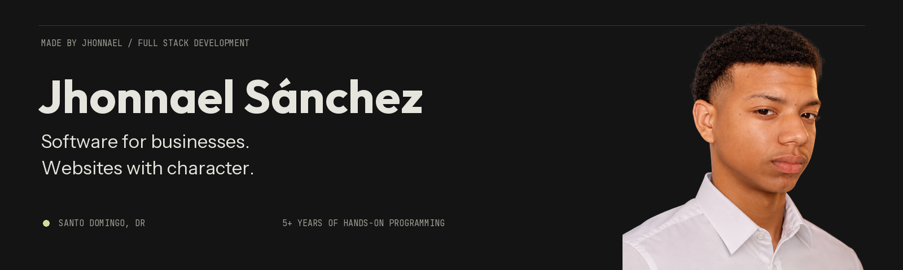
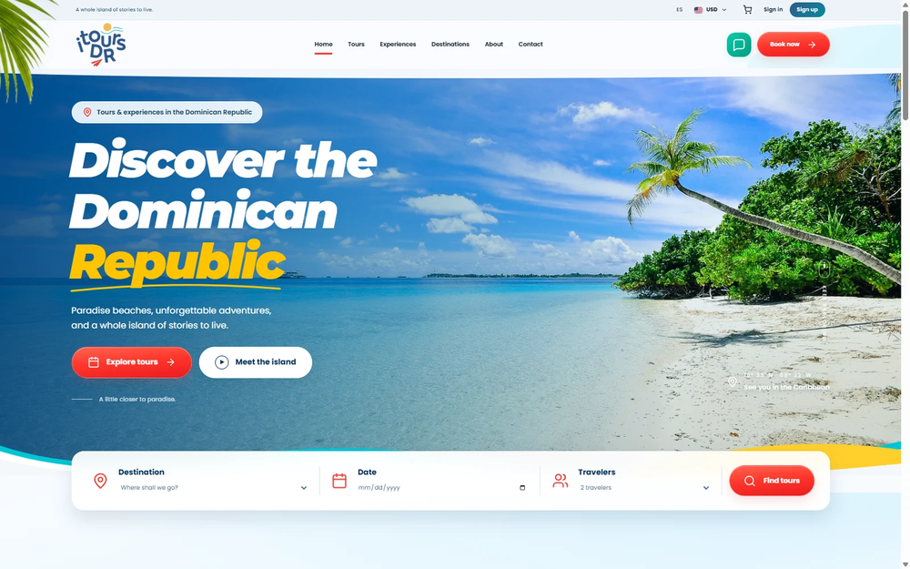
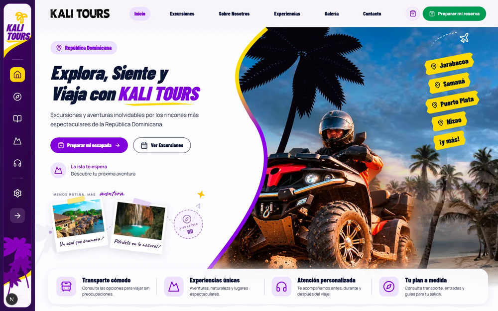
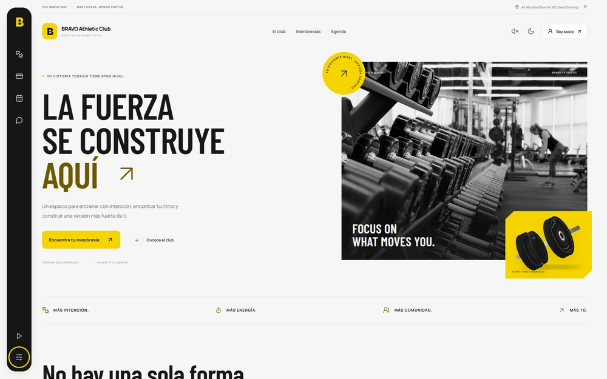
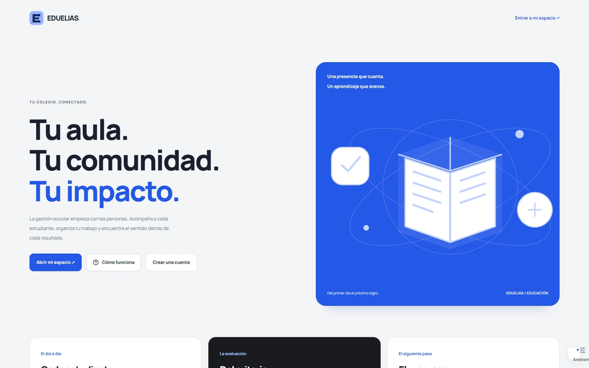
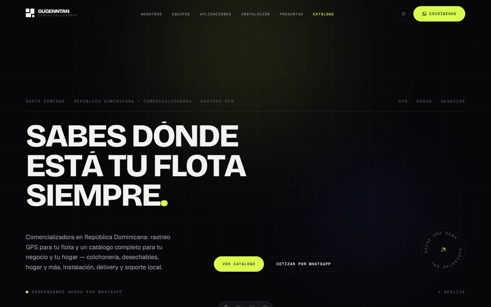
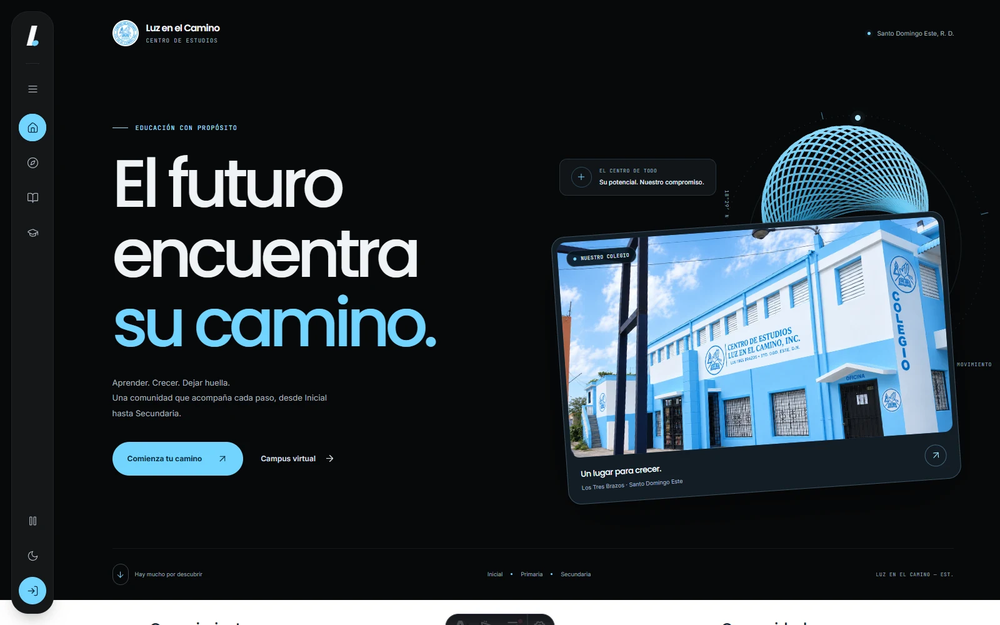
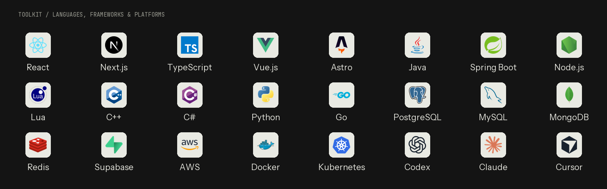

  

  <a href="https://madebyjhonnael.vercel.app"><strong>PORTFOLIO ↗</strong></a>
  &nbsp;&nbsp; / &nbsp;&nbsp;
  <a href="mailto:jhonnaelsanchez1@gmail.com"><strong>CONTACT</strong></a>
  &nbsp;&nbsp; / &nbsp;&nbsp;
  <a href="./assets/Jhonnael-Sanchez-CV.pdf"><strong>RÉSUMÉ ↓</strong></a>

## Software that solves real problems. Websites with character.

I'm **Jhonnael Sánchez**, a self-taught **Full Stack Software Developer** based in **Santo Domingo, Dominican Republic**, with **5+ years of hands-on programming experience**.

I started building game servers at 11 and later worked on custom Java plugins and server performance. Since 2025, my freelance work has focused on business applications: tourism platforms, school systems, restaurant operations, e-commerce, sports academies and internal workspaces.

I care about the whole product: the interface people use, the APIs behind it, the data model underneath it and the details that make the experience feel right.

---

## Featured work

<table>
  <tr>
    <td width="33%" valign="top">
      
       <strong>iTours DR</strong> 
      Tours, bookings and a dedicated traveler experience. 
      Astro · React · TypeScript · Supabase
    </td>
    <td width="33%" valign="top">
      
       <strong>Kali Tours</strong> 
      Tour discovery, destination pages, inquiries and operations. 
      Next.js · React · TypeScript · Supabase
    </td>
    <td width="33%" valign="top">
      
       <strong>BRAVO OS</strong> 
      Gym operations, memberships, billing and member experiences. 
      React · Vite · Node.js · SQLite
    </td>
  </tr>
  <tr>
    <td width="33%" valign="top">
      
       <strong>EDUELIAS</strong> 
      A connected workspace for teachers, attendance and assessment. 
      Astro · React · TypeScript · Supabase
    </td>
    <td width="33%" valign="top">
      
       <strong>Gugenntan</strong> 
      GPS tracking, fleet telematics and a commercial product catalog. 
      Astro · TypeScript · GSAP · Tailwind CSS
    </td>
    <td width="33%" valign="top">
      
       <strong>Colegio Luz en el Camino</strong> 
      School identity, academic management, enrollment and billing. 
      Astro · React · TypeScript · Supabase
    </td>
  </tr>
</table>

  <a href="https://madebyjhonnael.vercel.app"><strong>Explore the full portfolio →</strong></a>

## Project directory

The portfolio brings together **19 projects** across business software, websites, education and gaming.

| Project | Area | What it does |
| :--- | :--- | :--- |
| **iTours DR** | Tourism | Tour discovery, bookings, receipts and a private traveler area. |
| **Kali Tours** | Tourism | Cinematic website, excursion catalog, destination pages, inquiries and an operations preview. |
| **BRAVO OS** | Fitness | Gym operations, memberships, access, billing, workouts and a member portal. |
| **Colegio Luz en el Camino** | Education | Institutional website, student records, attendance, grades, enrollment and payments. |
| **EDUELIAS** | Education | Teacher workspace, academic context, attendance, evaluations and student follow-up. |
| **Verde Mesa** | Restaurants | QR menus, orders, tables, kitchen workflows, POS, inventory and financial tools. |
| **PapaToner** | Commerce | Office-supplies website, reference search, product compatibility, catalog and operations. |
| **NovaShip** | Logistics | Courier tracking, rates, lockers, customer areas and operations tools. |
| **Agencia Zentella** | Creative services | Bilingual agency website, portfolio and Studio Ops CRM. |
| **Provincia33** | Food & hospitality | Dominican street-food brand experience, menu, photography and social content. |
| **Shaddai Baseball Academy** | Sports | Academy website, tournaments, match results, registrations and administrative workflows. |
| **Gugenntan** | Telematics & commerce | GPS fleet-tracking presentation, device information and a commercial product catalog. |
| **AEMPLC** | Institutional | Church and worker records, forms, institutional documents and council administration. |
| **EG Migration Ops** | Professional services | Immigration case management, clients, deadlines, documents, appointments and billing. |
| **Wet Auto Import** | Automotive | Digital vehicle showroom, inventory presentation, specifications and advisor contact. |
| **Brasa y Masa** | Restaurants | Online ordering, restaurant dashboard, point of sale, inventory and finance. |
| **OtherNation Development** | Gaming | Interactive FiveM studio website, 3D identity, script catalog and documentation. |
| **NuevaEra RP** | Gaming & community | VIP store, Discord integration, Tebex purchase flow and community dashboard. |
| **EduMéndez** | Education | Academic management for classes, students, attendance, exams, assignments and reporting. |

**Project interfaces, imagery and details:** [madebyjhonnael.vercel.app](https://madebyjhonnael.vercel.app)

---

## Technical toolkit

| Focus | Technologies |
| :--- | :--- |
| **Frontend** | React · Next.js · Astro · Vue.js · TypeScript |
| **Backend & languages** | Java · Spring Boot · Node.js · Python · Go · C++ · C# · Lua |
| **Data & platforms** | PostgreSQL · MySQL · MongoDB · Redis · Supabase |
| **Cloud & infrastructure** | AWS · Docker · Kubernetes |
| **AI-assisted development** | Codex · Claude · Cursor |

**Areas I enjoy:** software architecture, API development, database optimization, thoughtful interfaces and end-to-end problem-solving.

## Background

- **Freelance software development** — business applications and digital experiences, **2025–present**.
- **Game-server development** — custom Java plugins, server systems and performance optimization.
- **Technical High School Diploma in Computer Applications** — Instituto Politécnico Profesor Juan Bosch, **2023–2026**.
- **English studies** — Academia de Lenguas Coral Mall. **B1+, working toward B2**.

## Let's build something useful.

For project inquiries, development opportunities or collaborations:

**Portfolio** — [madebyjhonnael.vercel.app](https://madebyjhonnael.vercel.app) 
**Email** — [jhonnaelsanchez1@gmail.com](mailto:jhonnaelsanchez1@gmail.com) 
**GitHub** — [@Inxiify](https://github.com/Inxiify) 
**Résumé** — [View / download PDF](./assets/Jhonnael-Sanchez-CV.pdf)

---

Made by Jhonnael · Santo Domingo, Dominican Republic

